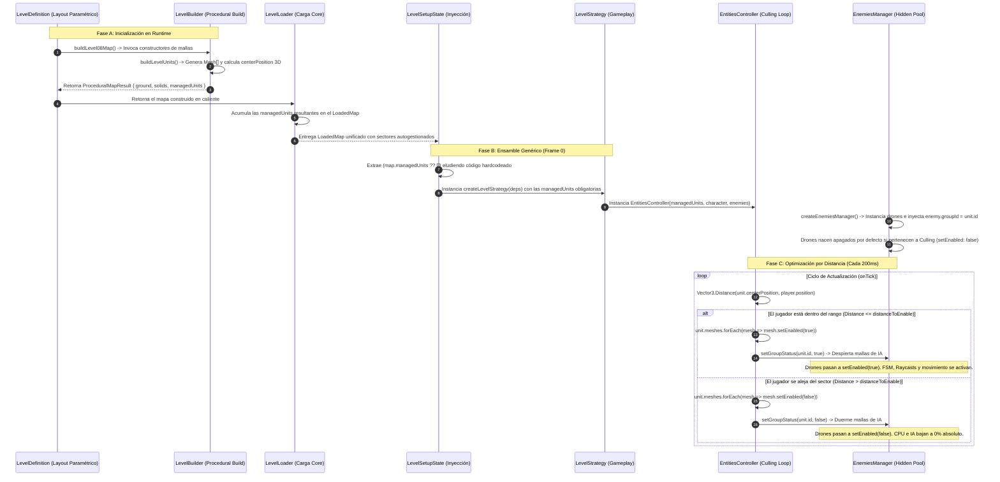

# Proceso de Creación de Nuevas Unidades de Nivel y Enemigos
Este documento sirve como punto de partida y guía técnica para expandir el mapa procedural e integrar nuevos tipos de drones o comportamientos lógicos en la arquitectura del juego.

---

## 🛠️ Archivos Requeridos para el Desarrollo

### 1. Capa de Datos y Configuración (Data-Driven)
*   `src/game/unit-builder.types.ts`: Para expandir el discriminante de tipos si tu unidad requiere propiedades paramétricas personalizadas (ej: agregar `"laser_tunnel"` al tipo `UnitKind`).
*   `src/game/definitions/level-XX-definition.ts`: Donde se declara el array paramétrico del nivel (`LEVEL_XX_LAYOUT`) y se configuran las posiciones estáticas de los nuevos enemigos (`PRE_SPAWNS`) inyectándoles obligatoriamente su identificador de sector (`groupId: unit.id`).

### 2. Capa de Construcción Geométrica (Builders)
*   `src/game/level-builder.ts`: El orquestador que aloja las funciones independientes con firma `UnitBuilderFn`. Aquí se codeará el ensamble visual en BabylonJS de la nueva unidad, asegurando que las mallas colisionables se inyecten en el array global de `solids` y las mallas visuales pasen de largo.

### 3. Capa de Inteligencia y Control del Enemigo (IA)
*   `src/game/entities/enemies/enemy-factory.ts`: El diccionario estático `ENEMY_BUILDERS` donde registrarás la factoría constructora de tu nuevo dron vinculándola a la enumeración de `EnemyType`.
*   `src/game/entities/enemies/[nuevo-dron]/[nuevo-dron].ts`: Clase concreta que hereda de `DroneBase` (o `EnemyBase`). Controla las mallas visuales del enemigo, sus ganchos de daño (`onHit`) y su ciclo de vida.
*   `src/game/entities/enemies/[nuevo-dron]/[nuevo-dron].fsm.ts`: Máquina de estados (FSM) que encapsula las transiciones de comportamiento de la nueva IA.

---

## 🔄 Diagrama de Flujo del Pipeline Procedural

El siguiente diagrama documenta de punta a punta cómo se transportan y conmutan las mallas y los enemigos en runtime de forma totalmente automatizada por proximidad tridimensional:

